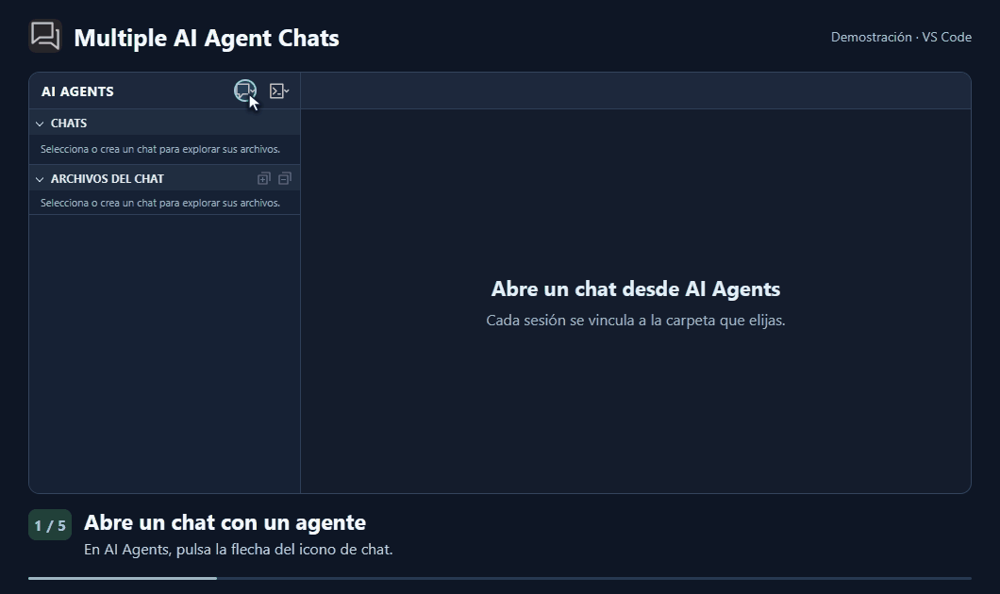

# Multiple AI Agent Chats

  [](LICENSE)

Manage Codex, Claude Code, and Ollama from the **AI Agents** sidebar in VS Code. Each chat or terminal can use a different local folder. Selecting a session also switches the file explorer to its folder.

**Español.** Gestiona chats de Codex, Ollama y Claude, abre Claude Code con tu suscripción en la carpeta de cada chat y ejecuta terminales de agentes en VS Code.

This project is independent of OpenAI, Anthropic, and Ollama.

**Supported agents / Agentes compatibles** · Claude Code · Codex · Ollama

## Demo



## Codex

Open independent chats with local history, attach files, and choose a permission mode. Install the official Codex CLI separately and sign in. If detection fails, set `multipleIAAgents.executables.codex` to its absolute path. JavaScript entry points such as `bin/codex.js` require Node.js on `PATH`.

## Claude Code

When you create a Claude chat, choose how to access Claude:

- **Official Claude Code.** Opens a new chat in Anthropic's panel for the primary workspace folder and lists it in AI Agents. For a different folder, AI Agents offers to open Claude Code in an integrated terminal in the same window. Claude Code manages its history and sign-in. Install and enable the Claude Code extension to use the native panel.
- **Claude with an API key.** Uses this extension's chat panel, with attachments, permission modes, and local history, like Codex and Ollama. Anthropic does not allow third-party extensions to offer Claude.ai sign-in or use subscription limits, so this chat uses your own Anthropic API key. Usage is billed to your API account. The key is stored encrypted in VS Code's secret storage. Claude Code runs in `--bare` mode, which only accepts that key. Use **Set Anthropic API key** or **Remove Anthropic API key** from the Command Palette to manage it.

The official [Claude Code extension](https://marketplace.visualstudio.com/items?itemName=anthropic.claude-code) is installed as a dependency and provides the Claude Code executable when it is not installed separately.

For terminal sessions, install the official Claude CLI or the Claude Code extension and sign in. The extension detects native and global npm installations, including Node.js version managers. If detection fails, set `multipleIAAgents.executables.claude`. JavaScript entry points require Node.js on `PATH`.

## Ollama

Use installed models for local chats and download models from the chat panel. Install Ollama separately and install a model to start chatting. The extension can use the local server on port 11434 or start its own on port 11435. If detection fails, set `multipleIAAgents.executables.ollama` to the executable's absolute path. Review each model's license and hardware requirements before using or distributing it. [Ollama downloads](https://ollama.com/download)

With a tool-capable model, you can ask the chat to list directories and read UTF-8 files in the chat folder. For files outside that folder, provide an absolute path. The chat asks for approval before sending external file contents to your local Ollama server. You can also attach files manually.

## Installation

Use VS Code 1.145 or later and open a trusted local workspace. Search for `Mauricio.multiple-ia-agents` in the **Extensions** view. To install a local build, run **Extensions: Install from VSIX...**, select the package in `artifacts/`, and reload VS Code.

## Using the sidebar

1. Open **AI Agents** from the Activity Bar or run **Multiple AI Agent Chats: Show AI Agents (no usage meters)** from the Command Palette.
2. Open the chat button's dropdown, choose an agent, and select a folder.
3. Select a session to return to it and browse its files. Double-click a Markdown file to open it in a floating editor.
4. In Codex or Ollama chats, open the chat history to see closed conversations from the current folder. Each entry shows the last text message you sent and its local date and time. Select an entry to restore it in the same panel. You can also run **Multiple AI Agent Chats: Reopen closed chat** from the Command Palette.

Use the formatting toolbar below the message input to add emphasis, lists, code, links, or tables. The formatting button below the draft shows or hides the toolbar. Paste text or PNG, JPEG, and WebP images directly into the message editor. Images appear as removable attachments and require a model that supports image input.

The extension interface is available in English and Spanish.

While a response is running, Enter or the send control queues your next message for that chat. The composer shows waiting messages and has a separate stop control.

## GitHub Markdown Vault

Use the Vault button in a chat to select a local Markdown folder. From the Vault explorer you can browse Markdown files, insert one into the current draft, or move it to the trash after confirmation. Use the Vault dialog to save the current conversation as Markdown.

The Vault works locally. If you choose to sync with GitHub, the extension verifies that the remote repository is private before syncing.

See the [changelog](CHANGELOG.md) for recent improvements to chat history, the Vault, and message controls.

## Terminal sessions

Open the terminal button's dropdown in **AI Agents**, select Codex, Claude, Ollama, or **Shell (no agent)**, and choose a starting folder. The terminal opens in the editor area. Select its sidebar entry to return to the terminal and browse its associated folder.

Closing the terminal removes its sidebar entry. Closing the entry also closes the terminal. Reopening it starts a new process in the saved folder. Changing directories inside the terminal preserves the folder associated with the session.

Agent terminals use the installed provider CLIs. The Ollama terminal uses an installed model. **Shell (no agent)** opens a system shell.

## Troubleshooting

- **Executable unavailable.** Install the official CLI and check its configured path. Use a native executable or JavaScript entry point. Files ending in `.cmd`, `.bat`, or `.ps1` are shell wrappers.
- **Ollama terminal fails to start.** Make sure Ollama is installed and run `ollama list` to verify that a model is available.
- **Claude terminal fails to start.** Make sure Claude Code is installed and signed in.
- **Claude API chat reports an invalid key.** Run **Set Anthropic API key** and enter a key from the Claude Console.
- **Controls are missing after an update.** Run **Developer: Reload Window** from the Command Palette.

## Privacy and permissions

Codex, Ollama, and Claude API chat history, session names, and folder paths are stored locally in VS Code's extension storage. The extension operates without telemetry. Each provider handles its own authentication.

Messages and selected attachments are sent to your chat provider. Codex can run commands or edit files according to the selected permission mode. [Privacy policy](PRIVACY.md)

## Development

Use Node.js 22 or later and npm.

```sh
npm ci --ignore-scripts
npm run check
npm test
npm run verify:privacy
npm run verify:history
npm run verify:distribution
npm run package
```

Packaging regenerates the third-party notices and verifies the VSIX. Tests use sample data and run without real credentials. Optional UI checks require Microsoft Edge.

```sh
node integration/sidebar.cjs
node integration/ui.cjs
```

The Marketplace publisher ID is `Mauricio`. [Publishing guide](PUBLISHING.md)

## License

The project uses the [MIT License](LICENSE). Original dependency licenses are in [licenses/](licenses/), listed in the [third-party notices](THIRD_PARTY_NOTICES.md), and recorded with checksums in [DEPENDENCY-LICENSES.json](DEPENDENCY-LICENSES.json).

Provider services, external apps, trademarks, and models have their own terms. See the [license review](LICENSE_REVIEW.md) and [review report](REVIEW_REPORT.md) for the scope of the technical review.
